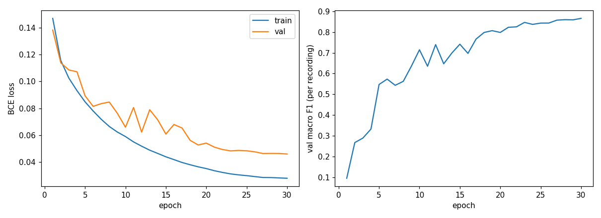
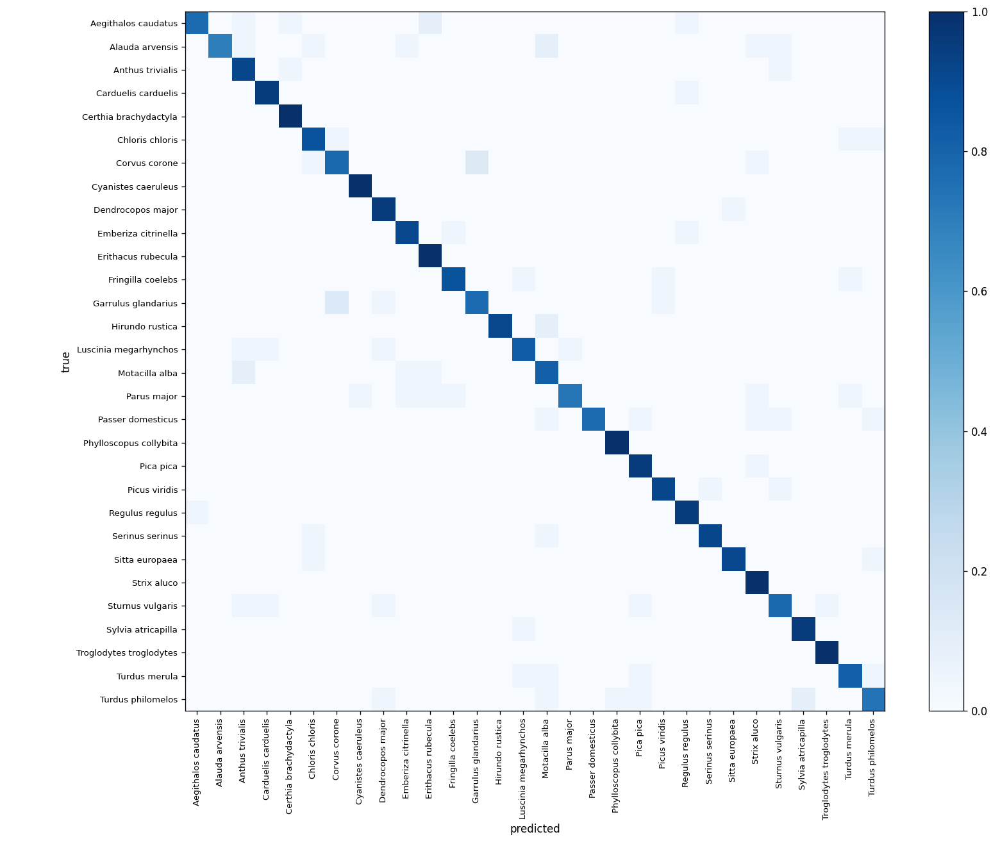

# Bird Species Classification from Acoustic Recordings

Multi-species bird identification from audio: 30 European species, log-mel
spectrograms, a convolutional neural network, and an honest evaluation protocol.

University AI course project (CSE3705). The working system, the experiment
log and the figures below are all in this repository.

---

## Results

30 species · 4,500 Xeno-canto recordings · 675 held-out test recordings ·
**scored per recording, not per window** · chance accuracy = 0.033

| Model | Features | Val acc | **Test acc** | Test macro-F1 |
|---|---|---|---|---|
| Random Forest (300 trees) | 20 MFCCs, mean + std (40-d) | 0.578 | **0.597** | 0.597 |
| **BirdCNN** (4 blocks, 396k params, 30 epochs, no augmentation) | log-mel, 128 × 313 | 0.867 | **0.883** | 0.882 |

The CNN improves on the classical baseline by **28.6 percentage points** on the
same split, the same cached spectrograms and the same scoring code.

Raw numbers including per-class recall: [`outputs/rf/results_rf.json`](outputs/rf/results_rf.json),
[`outputs/cnn/results_cnn.json`](outputs/cnn/results_cnn.json).

### Training



Loss and recording-level validation macro-F1 over 30 epochs. The jumpy phase up
to epoch 17 is the high-learning-rate regime; cosine decay smooths it after
that. The widening gap between the two loss curves is the onset of overfitting,
and is what motivates the augmentation experiments in Phase 3. Best epoch was
the last, so a longer run is the next experiment.

### Confusion



Row-normalised, so rows are true species and the diagonal *is* per-class recall.
Errors are diffuse rather than concentrated in pairs; the clearest surviving
confusion is Crow against Jay. The Random Forest's matrix is at
[`outputs/rf/confusion_rf_test.png`](outputs/rf/confusion_rf_test.png) for comparison.

### Per-species

Floor rose from 0.32 (Random Forest) to 0.70 (CNN). Six species reach 1.00 on
test — Robin, Blue Tit, Treecreeper, Chiffchaff, Wren, Tawny Owl — all with one
distinctive, stereotyped vocalisation.

The hardest species are the same under **both** models, which indicates the
difficulty is a property of the birds rather than of the architecture:

| Species | CNN test recall | Why it is hard |
|---|---|---|
| Skylark | 0.70 | Long unbroken song streams; selected windows all resemble each other |
| Great Tit | 0.73 | One of the largest song repertoires of any European bird |
| Song Thrush | 0.74 | Repeated-phrase structure overlaps with other thrushes |
| Starling | 0.78 | A mimic — its errors scatter across many species |

---

## What makes the number trustworthy

Two choices do most of the work, and both are easy to get wrong:

**Split by recording, never by window.** Windows from one recording overlap by
50% and share the same bird, microphone and background. If they land in both
train and test, the model is scored on data it has effectively seen. The split
is made at recording level, stratified by species, and **frozen** to
[`data/splits.csv`](data/splits.csv) — no notebook recomputes it. Validation
(0.867) and test (0.883) agreeing to within two points is what an uncontaminated
split looks like.

**Score per recording, not per window.** Training runs on 5-second windows, but
the unit anyone cares about is the recording. Window probabilities are averaged
per recording before any metric is computed. This is worth about 8 points
(0.827 → 0.883), because windows containing no call get outvoted — the
weak-label problem, measured rather than asserted.

**A weakness we measured and report rather than hide:** 181 of 217 test
recordists (83%) also appear in training, and contribution is highly
concentrated — the top 10 of 552 recordists supply 31.7% of the dataset. A model
could therefore score partly by recognising recording equipment. A
recordist-grouped split is planned as an explicit control. See
[`outputs/eda/`](outputs/eda/).

---

## Method

| Stage | What happens |
|---|---|
| **Data** | 4,500 Xeno-canto recordings, 30 species, 150 each, quality A/B, 3–60 s |
| **Preprocess** | 32 kHz mono → 5 s windows (50% overlap) → 128-band log-mel (50 Hz–16 kHz) → per-example normalisation |
| **Window selection** | Top 5 windows per recording by energy in the 1–10 kHz band |
| **Cache** | 20,483 windows stored as uint8 `(5, 128, 313)` arrays |
| **Model** | 4 × [Conv3×3 → BN → ReLU → MaxPool2], 32→64→128→256, global average pooling, linear |
| **Loss** | Per-class binary cross-entropy — *not* softmax |
| **Training** | AdamW, lr 1e-3 cosine decay, batch 64, mixed precision, best-val-F1 checkpoint |
| **Evaluation** | Recording-level accuracy, macro-F1, per-class recall worst-first, row-normalised confusion matrix |

**Why BCE and not softmax:** real soundscapes contain several species at once,
so the problem is multi-label. Committing to BCE now means out-of-domain
soundscape data can be introduced later without changing the model, the loss or
the metrics.

**Why 32 kHz:** bird calls carry real energy above 8 kHz. The Goldcrest in this
species set sits at roughly 7–8 kHz, which 16 kHz audio cannot represent.

**Why per-example normalisation:** recordings come from 552 different people
with different equipment. Normalising each example rather than the dataset stops
the model learning a particular microphone as a shortcut for a species.

**Why these 30 species:** chosen for acoustic interest, not for recording counts
(every candidate exceeded the 150 cap). Confusable groups were kept on purpose —
two thrushes, three tits, four finches, three very high-frequency species, three
corvids — so the confusion matrix is informative. Acoustically isolated species
(Cuckoo, Swift, Kestrel) were excluded because they would be near-free correct
predictions that inflate accuracy without testing anything.

---

## Repository layout

```
src/config.py        all audio + dataset parameters (change here, not inline)
src/fetch_data.py    Xeno-canto API v3 survey
src/preprocess.py    audio -> windows -> log-mel, plus sanity_check()
src/split.py         recording-level train/val/test split, frozen to CSV
src/build_cache.py   one-time spectrogram precompute
src/dataset.py       BirdWindows: window items, multi-hot labels, rec_id
src/model.py         BirdCNN
src/train.py         training loop
src/evaluate.py      shared scoring used by EVERY model
src/baseline_rf.py   Random Forest on MFCCs
src/eda.py           exploratory analysis

notebooks/kaggle_download.py   audio acquisition, run on Kaggle
data/splits.csv                the frozen split (committed)
outputs/                       results, figures
docs/LOG.md                    lab log: every step, decision and dead end
```

---

## Reproducing

Code lives here; audio and GPU live on Kaggle. Each notebook starts by cloning
this repository.

**1. Survey the species.** Needs a free Xeno-canto API key — the v2 API was
retired and v3 requires one. Get it from <https://xeno-canto.org/account>.

```bash
setx XC_API_KEY "your-key"      # then reopen the terminal
python -m src.fetch_data survey # writes data/species_shortlist.csv
```

**2. Download the audio — on Kaggle, not locally.** Xeno-canto rate-limits
residential connections to roughly 13 kB/s per IP, which puts a full download at
over a day. The same request from a Kaggle notebook runs at ~780 kB/s. Paste
[`notebooks/kaggle_download.py`](notebooks/kaggle_download.py) into a notebook
with Internet enabled and the key in Kaggle Secrets, then use **Save & Run All
(Commit)** — an interactive session's output is discarded. ~3 hours.

**3. Split, cache, train.** Attach the download's output as notebook input:

```bash
python -m src.split       <raw_dir> data/splits.csv
python -m src.build_cache <raw_dir> <cache_dir>
python -m src.baseline_rf <cache_dir> outputs/rf
python -m src.train       <cache_dir> outputs/cnn     # ~8 min on a T4
python -m src.eda --splits data/splits.csv --raw <raw_dir> --cache <cache_dir> --out outputs/eda
```

**Before training anything, look at the spectrograms.** Preprocessing bugs do
not crash — they quietly make a model mediocre while the blame falls on the
architecture.

```python
from src.preprocess import sanity_check
sanity_check(paths, "outputs/sanity.png")
```

---

## Status

**Phases 1 and 2 complete** — data pipeline, baseline, CNN, per-class analysis.

In progress:

- Longer training run and augmentation ablations (SpecAugment-style masking,
  mixup, background-noise mixing), each measured separately
- **Phase 3, the actual research question:** the focal-to-soundscape gap. The
  model is trained on clean, close-range recordings; real field soundscapes are
  distant, overlapping and noisy, and performance is expected to drop sharply.
  Measuring that drop and then reducing it is the project's contribution — a
  single accuracy number on clean data is not.
- Grad-CAM explainability, then a deployment demo

[`docs/LOG.md`](docs/LOG.md) records every step with its reasoning, the dead
ends, and the numbers with the commit that produced them.

---

## Data and attribution

Training audio from [Xeno-canto](https://xeno-canto.org), a volunteer archive.
Every recording's recordist, licence and country is preserved in the
`metadata.jsonl` written at download time. Audio is not committed to this
repository.
